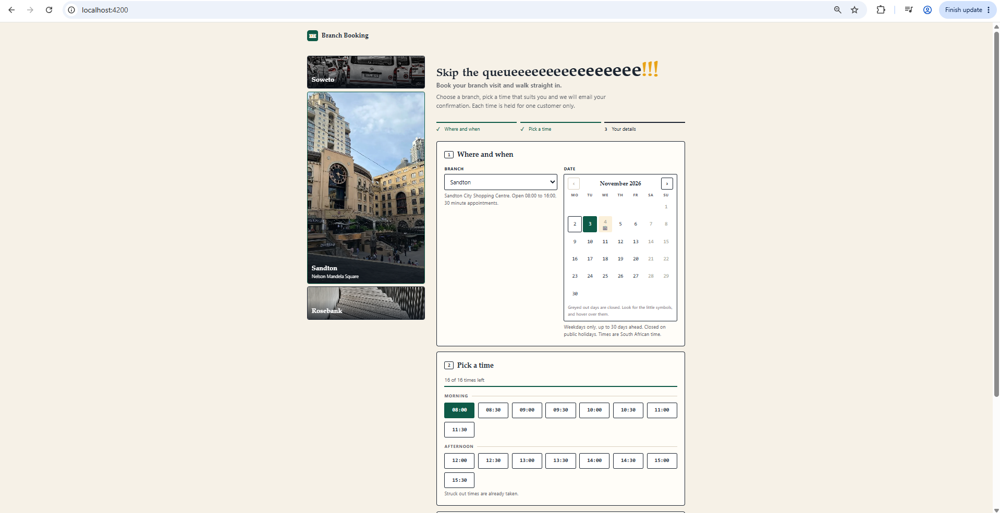
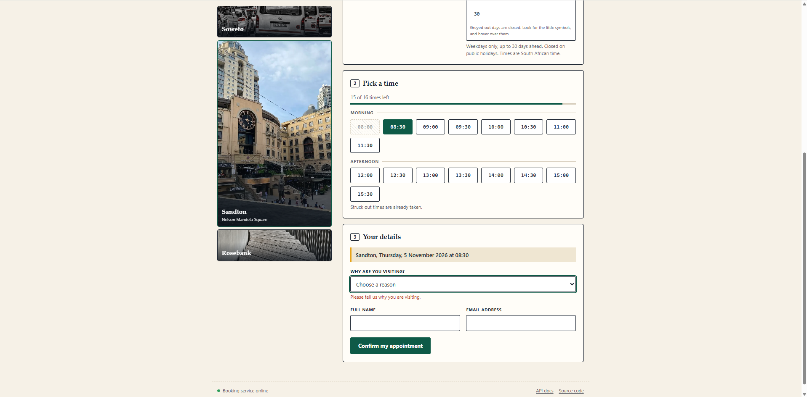
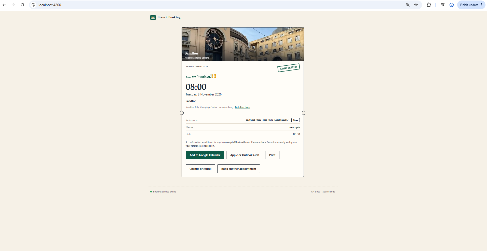
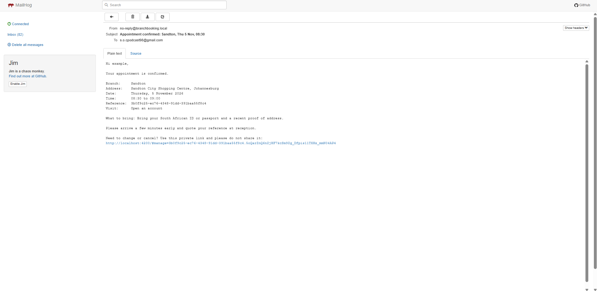
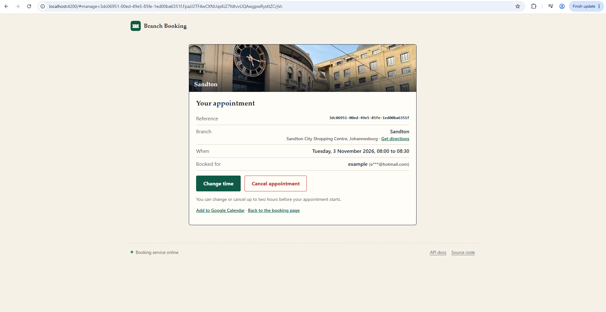
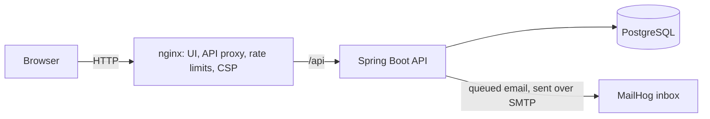
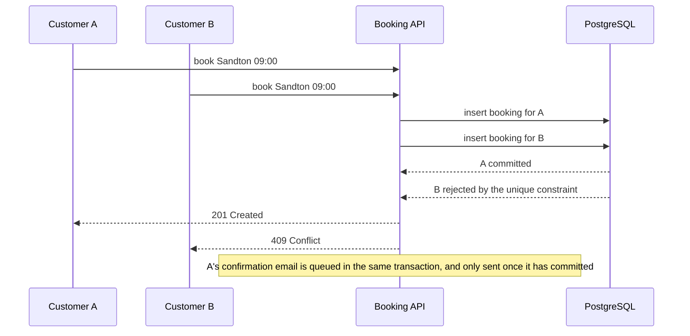

# Branch Appointment Booking

A full-stack application for scheduling branch appointments. Customers choose a branch, a date and a time slot, and receive a confirmation email. A slot can never be booked twice, even when many people try at the same moment.

- **Backend:** Java 21, Spring Boot 4, Spring Data JPA, PostgreSQL, Flyway, springdoc OpenAPI
- **Frontend:** Angular (standalone components, signals, reactive forms), served by nginx
- **Email:** confirmation sent after the booking commits; MailHog catches it locally
- **Delivery:** multi-stage Docker images, one-command `docker compose`, GitHub Actions CI

## Reviewer's guide

**Run it in two minutes.** You need Docker with Compose, and ports 8081 and 8025 free:

    docker compose up --build

Then open http://localhost:8081. The first build downloads images and takes a few minutes.

**Five things worth trying**

1. Pick a branch by clicking its photo, choose a weekday and book a time. The confirmation email arrives in the MailHog inbox at http://localhost:8025.
2. Open the page in two browser tabs, choose the same time in both and submit both. One booking wins and the other is told the time was just taken. The database decides, not the application code.
3. Click ahead in the calendar. Weekends and public holidays are closed (try 4 November 2026), and holidays and seasonal days have their own symbols.
4. Use "Change or cancel" on the confirmation, or the private link in the email, to move or cancel the booking.
5. Open http://localhost:8081/swagger-ui.html and call the API directly.

**Where the interesting code is**

| Topic | Where |
|-------|-------|
| The double-booking guarantee | the unique constraint in `V2__create_bookings.sql`, and `BookingService.create` |
| Proof under concurrency | `BookingFlowTests` (12 simultaneous requests), `BookingConcurrencyTests`, `IdempotencyFlowTests`, `BookingManagementFlowTests` |
| Safe retries | `IdempotencyKey`, `BookingController` |
| Change and cancel with a private token | `ManageTokens`, `BookingChangeService` |
| Email that cannot be lost | `EmailOutboxWriter`, `EmailOutboxDispatcher` |
| South African public holidays | `PublicHolidayCalendar` |
| Edge security | `frontend/nginx.conf`, `SecurityHeadersFilter` |
| The pipeline | `.github/workflows/ci.yml` |

## Demo

https://github.com/user-attachments/assets/71fd2b8d-ebad-4a1a-a372-9b0eba21229e

## Screenshots

**Choose a branch by its photo, then a day on a calendar that knows South African public holidays.**

**Say why you are visiting, and see what to bring.**

**A confirmation slip, and the confirmation email in the inbox.**

**Change or cancel with the private link.**

## Architecture

Two customers click the same slot at the same moment. The database, not the application code, decides the winner:

## Run it with Docker (recommended)

Prerequisite: Docker with Compose.

    docker compose up --build

Then open:

| What | URL |
|------|-----|
| The application | http://localhost:8081 |
| API documentation (Swagger UI) | http://localhost:8081/swagger-ui.html |
| Email inbox (MailHog) | http://localhost:8025 |

Book an appointment, then open MailHog to see the confirmation email. Stop everything with `docker compose down` (add `-v` to also delete the database volume).

Each image has its own Dockerfile: `backend/Dockerfile` and `frontend/Dockerfile`. Both are multi-stage builds and run as a non-root user.

### Ports

The stack publishes only two ports on your machine: the application on `8081` and the MailHog inbox on `8025`. Postgres and the API container are reachable only inside the Docker network, so the stack does not clash with a Postgres you already run locally. If either port is taken, choose others:

    APP_PORT=9090 PUBLIC_BASE_URL=http://localhost:9090 MAILHOG_PORT=9025 docker compose up --build

On Windows PowerShell set the variables first, for example `$env:APP_PORT = "9090"`.

To run the backend outside Docker against containerised Postgres and MailHog, publish their ports with the dev override:

    docker compose -f docker-compose.yml -f docker-compose.dev.yml up -d postgres mailhog

To open a SQL shell: `docker compose exec postgres psql -U booking -d booking`.

## Run it without Docker

Prerequisites: Java 21, Node 22 or newer. No database is needed, because the `local` profile uses an in-memory database that is seeded with three demo branches on every start.

Backend (http://localhost:8080):

    cd backend
    ./mvnw spring-boot:run -Plocal -Dspring-boot.run.profiles=local

On Windows PowerShell, quote the options:

    .\mvnw.cmd spring-boot:run "-Plocal" "-Dspring-boot.run.profiles=local"

Frontend (http://localhost:4200, proxies `/api` to the backend):

    cd frontend
    npm install
    npm start

In this mode confirmation emails are simulated: they are written to the application log instead of being sent. To see real emails, run MailHog (a single executable, no Docker needed) and start the backend with `BOOKING_MAIL_ENABLED=true` and `PUBLIC_BASE_URL=http://localhost:4200`, so the private link in the email opens the development server.

## Test it

Backend (unit, web layer and full integration tests, including a concurrent double-booking test):

    cd backend
    ./mvnw verify

Frontend:

    cd frontend
    npm test -- --watch=false

By default the backend tests run against an in-memory database so they work anywhere. CI runs the same suite against a real PostgreSQL instance by overriding the datasource settings with environment variables, then starts the complete Docker stack and runs an end-to-end smoke test: it books a slot over HTTP, checks that a second attempt is rejected with `409`, and checks that the confirmation email arrives in MailHog.

## API

Interactive documentation is available at `/swagger-ui.html`. The OpenAPI document is at `/v3/api-docs`.

| Method | Path | Description |
|--------|------|-------------|
| GET | `/api/v1/branches` | List branches |
| GET | `/api/v1/branches/{id}` | Get one branch |
| GET | `/api/v1/branches/{id}/slots?date=YYYY-MM-DD` | Every slot in the day, with availability |
| POST | `/api/v1/bookings` | Book a slot. Returns `201`, or `409` if the slot is taken |
| GET | `/api/v1/bookings/{reference}` | Look up a booking |
| GET | `/api/v1/holidays?year=YYYY` | South African public holidays, on which branches are closed |
| GET | `/api/v1/bookings/{reference}/manage` | View a booking with its private token (`X-Manage-Token` header) |
| PATCH | `/api/v1/bookings/{reference}` | Move a booking to another slot at the same branch |
| DELETE | `/api/v1/bookings/{reference}` | Cancel a booking and free the slot |
| GET | `/api/v1/reasons` | The reasons for a visit, each with a note on what to bring |
| POST | `/api/v1/admin/branches` | Create a branch (needs `X-Admin-Key`, off unless `ADMIN_API_KEY` is set) |
| PUT | `/api/v1/admin/branches/{id}` | Update a branch (same key, refused while the schedule has upcoming bookings) |

Errors use RFC 7807 problem responses. Validation errors include the failing fields.

Example:

    curl -X POST http://localhost:8081/api/v1/bookings \
      -H "Content-Type: application/json" \
      -d '{"branchId":1,"date":"2026-11-02","startTime":"09:00","customerName":"Thandi Nkosi","customerEmail":"thandi@example.com"}'

## Design decisions

**Double-booking is prevented by the database.** The `bookings` table has a unique constraint on `(branch_id, appointment_date, start_time)`. The service checks availability first so that the common case returns a friendly error, but that check alone is racy, so the constraint is the real guarantee. A request that loses the race hits the constraint, and the service turns that into `409 Conflict`. A test fires 12 simultaneous requests at one slot and asserts that exactly one succeeds.

**Slots are computed, not stored.** Each branch has opening hours and a slot length. The API generates the slot grid for a date and marks the ones that are already booked or in the past. There is no slot table to seed or keep in sync. Each slot holds exactly one booking.

**Email goes through a transactional outbox.** When a booking is saved, cancelled or moved, the email is written to an `email_outbox` table in the same database transaction, so a committed booking always has its email queued and a rolled-back one never does. A dispatcher polls the table, sends over SMTP and retries failures with exponential backoff, giving up after a set number of attempts and keeping the row as `FAILED`. Several instances can run it safely because each row is claimed with an atomic update. Delivery is at least once: a crash between sending and marking a row as sent could send a duplicate, which is better than losing a confirmation. The confirmation contains the private manage token, so the body is erased once the email is delivered. Old rows are removed by the retention job, and a gauge (`outbox_emails{status="failed"}`) is there to alert on. Tests cover delivery, retry, giving up, and the committed and rolled-back cases.

**Time is explicit.** The business time zone is configurable (`Africa/Johannesburg` by default) and all date logic goes through an injectable `Clock`, so tests control time.

**Same-origin API.** In Docker, nginx serves the UI and proxies `/api` to the backend, so the browser talks to one origin and the backend needs no CORS configuration. In development the Angular dev server proxies `/api` the same way.

**One customer cannot hoard slots.** An email address may hold at most three upcoming appointments, otherwise the API answers `422`. Unlike the slot rule, this is a soft limit checked in the service, not a database constraint, so two simultaneous requests from the same email could slip past it. That trade-off is acceptable for anti-hoarding. A double booking is not, which is why only the slot rule is enforced by the database.

**Retries are safe.** The browser sends a random `Idempotency-Key` with each booking attempt. The server stores the key in the same transaction as the booking, so a repeat of the same request returns the original booking (flagged with `Idempotent-Replayed: true`) and sends no second email. The same key with a different request is rejected with `422`. If identical requests arrive at the same moment, the one that loses the slot race hands back the winner's booking, and a test proves it with eight simultaneous requests. After one dropped connection the browser retries once by itself, which is only safe because of the key.

**Branches are closed on South African public holidays.** The calendar is computed rather than hard-coded: the fixed dates, Good Friday and Family Day derived from Easter, and the rule in the Public Holidays Act that a holiday falling on a Sunday is observed on the Monday. One-off holidays declared by the President, such as Local Government Elections Day on 4 November 2026, are listed explicitly. The API refuses to list or book slots on those days, and the frontend reads the same list from `/api/v1/holidays`, so there is one source of truth.

**Customers can change or cancel with a private link.** Creating a booking returns a 256 bit random token once and emails it as a link (`/#manage=<reference>.<token>`). Only its SHA-256 hash is stored, so a database leak cannot be used to change bookings, and it is compared in constant time. The token sits in the URL fragment, which browsers never send to the server, so it stays out of access logs and referrers. A wrong token and an unknown reference give the same `404`, so bookings cannot be probed. Cancelling deletes the booking, which frees the slot without touching the double-booking constraint, and a history table records what happened without any personal data. Moving a booking updates the same row, so the unique slot constraint still decides every race, and a version column makes two simultaneous changes to one booking fail with `409` instead of overwriting each other. Changes are refused within two hours of the start time (configurable).

**Personal data is kept only as long as it is needed.** Bookings, with the customer name and email address, are deleted 90 days after the appointment (`RETENTION_DAYS`), by a nightly job. Idempotency keys go with their booking, and the booking history never contains personal data. This follows the data minimisation principle of South Africa's POPIA.

**Visits have a reason.** The customer says why they are coming (open an account, replace a card, get help with a problem, update details, loans and savings, or something else). The list comes from `/api/v1/reasons` together with a short "what to bring" note, which is shown on the form, the slip and the email, and the reason is stored on the booking and counted in the metrics.

**Branches are managed through an admin API that is off by default.** The application has no customer login, so a public endpoint for editing branches would be reckless. Setting `ADMIN_API_KEY` switches on `POST /api/v1/admin/branches` and `PUT /api/v1/admin/branches/{id}`, guarded by an `X-Admin-Key` header that is compared as hashes in constant time and checked before the request body is read. Without a key the endpoints answer `404`, so they do not advertise themselves. Opening hours and appointment length cannot change while a branch has upcoming bookings, because moving the slot grid would strand them. Time slots themselves are computed from those two settings, so there is nothing separate to maintain.

    ADMIN_API_KEY=change-me docker compose up --build
    curl -X POST http://localhost:8081/api/v1/admin/branches \
      -H "X-Admin-Key: change-me" -H "Content-Type: application/json" \
      -d '{"name":"Pretoria Central","address":"Church Square","city":"Pretoria","opensAt":"08:00","closesAt":"16:00","slotMinutes":30}'

**There are business metrics.** Bookings created, cancelled and moved are counted after they commit, and `/actuator/prometheus` serves them with the standard HTTP metrics (conflicts show up as status 409). nginx does not proxy that endpoint, so it is reachable only inside the Docker network, where a Prometheus server would scrape it.

**Day and night mode.** The theme follows the device setting, and a sun and moon switch in the header overrides it and remembers the choice. A small script file applies the theme before the first paint so there is no flash. It is a file and not inline code because the Content-Security-Policy forbids inline scripts. The dark colours are a layer of variable overrides, so light mode is untouched, and printing is always light.

**Schema is owned by Flyway.** Hibernate only validates the entities against the migrations (`ddl-auto: validate`).

## Configuration

All configuration is through environment variables, with local defaults.

| Variable | Default | Purpose |
|----------|---------|---------|
| `DB_URL` | `jdbc:postgresql://localhost:5432/booking` | JDBC URL |
| `DB_USER` | `booking` | Database user |
| `DB_PASSWORD` | `booking` | Database password |
| `MAIL_HOST` | `localhost` | SMTP host |
| `MAIL_PORT` | `1025` | SMTP port |
| `MAIL_FROM` | `no-reply@branchbooking.local` | Sender address |
| `MAIL_ENABLED` | `true` | `false` simulates email by logging it |
| `BOOKING_TIMEZONE` | `Africa/Johannesburg` | Business time zone |

The defaults are for local development only. Real deployments must supply their own credentials.

## Project layout

    backend/    Spring Boot service (branch, slot, booking, notification packages)
    frontend/   Angular application and nginx configuration
    docker-compose.yml   Postgres, MailHog, backend and frontend
    .github/workflows/   CI: backend tests on Postgres, frontend build and tests, full-stack smoke test

## Troubleshooting

- **The private link in an email does not open.** The link is built from the `PUBLIC_BASE_URL` setting, which defaults to `http://localhost:8081`. That is right when your browser runs on the same machine as Docker. In a GitHub Codespace or on another machine, set it to the address your browser uses, for example `PUBLIC_BASE_URL=https://$CODESPACE_NAME-8081.$GITHUB_CODESPACES_PORT_FORWARDING_DOMAIN docker compose up --build`. It comes from configuration on purpose, never from request headers, which would let an attacker make the system email victims links to a domain they control. The "Change or cancel" button on the confirmation page works either way.
- **A port is already in use.** Choose other ports: `APP_PORT=9090 PUBLIC_BASE_URL=http://localhost:9090 MAILHOG_PORT=9025 docker compose up --build`. In PowerShell, set `$env:APP_PORT = "9090"` and `$env:MAILHOG_PORT = "9025"` first.
- **The first start is slow.** The images are built and downloaded once, which takes a few minutes. The API container waits for the database and the web container waits for the API, so give it up to a minute after the build before opening the page.
- **Apple Silicon.** MailHog only publishes an amd64 image, so Docker runs it under emulation. That is expected and works.
- **Start from a clean slate.** `docker compose down -v` also deletes the database volume.
- **Nothing in the inbox.** Emails are sent just after the booking is saved, so give it a second and refresh http://localhost:8025.
- **No Docker?** `./mvnw verify` in `backend` and `npm test -- --watch=false` in `frontend` need only Java 21 and Node. The backend tests use an in-memory database.

## Security

- **Double booking is impossible, not just unlikely.** A unique database constraint decides the winner, and a test proves it under 12 simultaneous requests.
- **Input is validated** at the API boundary (types, lengths, email format, no control characters in names). All database access is parameterised through JPA. The confirmation email is plain text and its subject never contains customer input.
- **Personal data is minimised.** Looking up a booking returns a masked email address, API responses are sent with `Cache-Control: no-store`, and logs carry a request id instead of personal details.
- **The edge is hardened** (nginx): a rate limit on writes (6 bookings a minute per IP with a small burst), a 16 kB request body cap, a Content-Security-Policy, `X-Content-Type-Options`, `X-Frame-Options`, a referrer policy and a permissions policy, with the server version hidden. The API is same-origin, so no CORS is configured.
- **Containers run with least privilege:** non-root users, no privilege escalation, all Linux capabilities dropped. Only the application and the mail inbox are published on the host. Postgres and the API are reachable inside the Docker network only.
- **Supply chain:** Dependabot opens weekly update pull requests, CodeQL scans the Java and TypeScript code on every push and weekly, and the CI token is read-only.
- **The API documentation can be switched off** with `SWAGGER_ENABLED=false`, which also disables the OpenAPI document.
- **Secrets come from the environment.** The defaults are for local development only.

What a production deployment would still need: authentication for customers and staff (Spring Security with OIDC), TLS and HSTS at the load balancer, a shared rate limiter if there is more than one instance, and audit logging.

## Known limitations and next steps

- **No tracing, dashboards or alerts yet.** Every request has an id in the logs and error bodies, there are liveness and readiness probes, and business metrics are exposed for Prometheus. Distributed tracing with OpenTelemetry, Grafana dashboards and alert rules are the next step.

- **Proclaimed one-off holidays must be added by hand.** They are gazetted at short notice, so they live in one list in `PublicHolidayCalendar`. A production system would read them from a maintained source.

- **The retention job runs on every instance.** That is safe because deleting the same old rows twice does nothing, but a lock such as ShedLock would stop the duplicate work.

- **There is no customer login, on purpose.** Booking is meant to be frictionless, so anyone can book, and a booking is managed with its private token instead of an account. The protections are the per-IP rate limit, the per-email limit on upcoming bookings and unguessable tokens that are stored only as hashes. If abuse appeared, the next steps would be bot protection such as a CAPTCHA and verifying the email address before confirming. Anything staff-facing would need real authentication, for example OIDC.
- **Emails are delivered at least once, and nothing alerts on failures yet.** A crash between sending and marking a row as sent can produce a duplicate email. Rows that fail every attempt stay in the table as `FAILED` and are visible through a gauge, but no alert rule is wired to it.
- **A replayed booking request carries no manage link, and a booking cannot move to another branch.** The token is shown once and only its hash is stored, so a retry after a lost response cannot return it. The confirmation email always carries it, and the email is now guaranteed to be sent, so nothing is lost. Moving to a different branch is deliberate: cancel and book again, which keeps each change simple to reason about.
- **Swagger UI is publicly exposed.** In production it should be disabled or protected (`springdoc.api-docs.enabled=false`, `springdoc.swagger-ui.enabled=false`).
