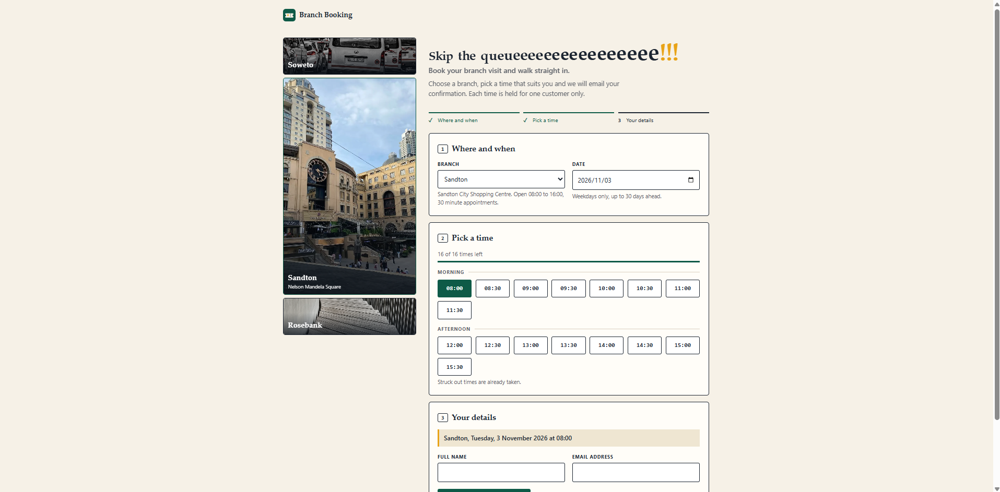
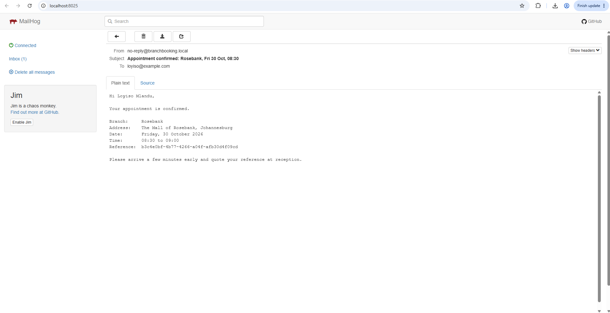

# Branch Appointment Booking

A full-stack application for scheduling branch appointments. Customers choose a branch, a date and a time slot, and receive a confirmation email. A slot can never be booked twice, even when many people try at the same moment.

- **Backend:** Java 21, Spring Boot 4, Spring Data JPA, PostgreSQL, Flyway, springdoc OpenAPI
- **Frontend:** Angular (standalone components, signals, reactive forms), served by nginx
- **Email:** confirmation sent after the booking commits; MailHog catches it locally
- **Delivery:** multi-stage Docker images, one-command `docker compose`, GitHub Actions CI

## Screenshots

## Run it with Docker (recommended)

Prerequisite: Docker with Compose.

    docker compose up --build

Then open:

| What | URL |
|------|-----|
| The application | http://localhost:8081 |
| API documentation (Swagger UI) | http://localhost:8081/swagger-ui.html |
| Email inbox (MailHog) | http://localhost:8025 |

Book an appointment, then open MailHog to see the confirmation email. Stop everything with `docker compose down` (add `-v` to also delete the database volume).

Each image has its own Dockerfile: `backend/Dockerfile` and `frontend/Dockerfile`. Both are multi-stage builds and run as a non-root user.

### Ports

The stack publishes only two ports on your machine: the application on `8081` and the MailHog inbox on `8025`. Postgres and the API container are reachable only inside the Docker network, so the stack does not clash with a Postgres you already run locally. If either port is taken, choose others:

    APP_PORT=9090 MAILHOG_PORT=9025 docker compose up --build

On Windows PowerShell set the variables first, for example `$env:APP_PORT = "9090"`.

To run the backend outside Docker against containerised Postgres and MailHog, publish their ports with the dev override:

    docker compose -f docker-compose.yml -f docker-compose.dev.yml up -d postgres mailhog

To open a SQL shell: `docker compose exec postgres psql -U booking -d booking`.

## Run it without Docker

Prerequisites: Java 21, Node 22 or newer. No database is needed, because the `local` profile uses an in-memory database that is seeded with three demo branches on every start.

Backend (http://localhost:8080):

    cd backend
    ./mvnw spring-boot:run -Plocal -Dspring-boot.run.profiles=local

On Windows PowerShell, quote the options:

    .\mvnw.cmd spring-boot:run "-Plocal" "-Dspring-boot.run.profiles=local"

Frontend (http://localhost:4200, proxies `/api` to the backend):

    cd frontend
    npm install
    npm start

In this mode confirmation emails are simulated: they are written to the application log instead of being sent.

## Test it

Backend (unit, web layer and full integration tests, including a concurrent double-booking test):

    cd backend
    ./mvnw verify

Frontend:

    cd frontend
    npm test -- --watch=false

By default the backend tests run against an in-memory database so they work anywhere. CI runs the same suite against a real PostgreSQL instance by overriding the datasource settings with environment variables, then starts the complete Docker stack and runs an end-to-end smoke test: it books a slot over HTTP, checks that a second attempt is rejected with `409`, and checks that the confirmation email arrives in MailHog.

## API

Interactive documentation is available at `/swagger-ui.html`. The OpenAPI document is at `/v3/api-docs`.

| Method | Path | Description |
|--------|------|-------------|
| GET | `/api/v1/branches` | List branches |
| GET | `/api/v1/branches/{id}` | Get one branch |
| GET | `/api/v1/branches/{id}/slots?date=YYYY-MM-DD` | Every slot in the day, with availability |
| POST | `/api/v1/bookings` | Book a slot. Returns `201`, or `409` if the slot is taken |
| GET | `/api/v1/bookings/{reference}` | Look up a booking |

Errors use RFC 7807 problem responses. Validation errors include the failing fields.

Example:

    curl -X POST http://localhost:8081/api/v1/bookings \
      -H "Content-Type: application/json" \
      -d '{"branchId":1,"date":"2026-11-02","startTime":"09:00","customerName":"Thandi Nkosi","customerEmail":"thandi@example.com"}'

## Design decisions

**Double-booking is prevented by the database.** The `bookings` table has a unique constraint on `(branch_id, appointment_date, start_time)`. The service checks availability first so that the common case returns a friendly error, but that check alone is racy, so the constraint is the real guarantee. A request that loses the race hits the constraint, and the service turns that into `409 Conflict`. A test fires 12 simultaneous requests at one slot and asserts that exactly one succeeds.

**Slots are computed, not stored.** Each branch has opening hours and a slot length. The API generates the slot grid for a date and marks the ones that are already booked or in the past. There is no slot table to seed or keep in sync. Each slot holds exactly one booking.

**Email is sent after commit, off the request thread.** The booking publishes an event inside its transaction. A listener runs only after the transaction commits, so a rolled-back booking never produces a confirmation. It runs asynchronously, so a slow mail server never slows the booking down, and a mail failure is logged and can never undo a booking. Tests prove the committed, lost-race and rolled-back cases.

**Time is explicit.** The business time zone is configurable (`Africa/Johannesburg` by default) and all date logic goes through an injectable `Clock`, so tests control time.

**Same-origin API.** In Docker, nginx serves the UI and proxies `/api` to the backend, so the browser talks to one origin and the backend needs no CORS configuration. In development the Angular dev server proxies `/api` the same way.

**One customer cannot hoard slots.** An email address may hold at most three upcoming appointments, otherwise the API answers `422`. Unlike the slot rule, this is a soft limit checked in the service, not a database constraint, so two simultaneous requests from the same email could slip past it. That trade-off is acceptable for anti-hoarding. A double booking is not, which is why only the slot rule is enforced by the database.

**Retries are safe.** The browser sends a random `Idempotency-Key` with each booking attempt. The server stores the key in the same transaction as the booking, so a repeat of the same request returns the original booking (flagged with `Idempotent-Replayed: true`) and sends no second email. The same key with a different request is rejected with `422`. If identical requests arrive at the same moment, the one that loses the slot race hands back the winner's booking, and a test proves it with eight simultaneous requests. After one dropped connection the browser retries once by itself, which is only safe because of the key.

**Schema is owned by Flyway.** Hibernate only validates the entities against the migrations (`ddl-auto: validate`).

## Configuration

All configuration is through environment variables, with local defaults.

| Variable | Default | Purpose |
|----------|---------|---------|
| `DB_URL` | `jdbc:postgresql://localhost:5432/booking` | JDBC URL |
| `DB_USER` | `booking` | Database user |
| `DB_PASSWORD` | `booking` | Database password |
| `MAIL_HOST` | `localhost` | SMTP host |
| `MAIL_PORT` | `1025` | SMTP port |
| `MAIL_FROM` | `no-reply@branchbooking.local` | Sender address |
| `MAIL_ENABLED` | `true` | `false` simulates email by logging it |
| `BOOKING_TIMEZONE` | `Africa/Johannesburg` | Business time zone |

The defaults are for local development only. Real deployments must supply their own credentials.

## Project layout

    backend/    Spring Boot service (branch, slot, booking, notification packages)
    frontend/   Angular application and nginx configuration
    docker-compose.yml   Postgres, MailHog, backend and frontend
    .github/workflows/   CI: backend tests on Postgres, frontend build and tests, full-stack smoke test

## Security

- **Double booking is impossible, not just unlikely.** A unique database constraint decides the winner, and a test proves it under 12 simultaneous requests.
- **Input is validated** at the API boundary (types, lengths, email format, no control characters in names). All database access is parameterised through JPA. The confirmation email is plain text and its subject never contains customer input.
- **Personal data is minimised.** Looking up a booking returns a masked email address, API responses are sent with `Cache-Control: no-store`, and logs carry a request id instead of personal details.
- **The edge is hardened** (nginx): a rate limit on writes (6 bookings a minute per IP with a small burst), a 16 kB request body cap, a Content-Security-Policy, `X-Content-Type-Options`, `X-Frame-Options`, a referrer policy and a permissions policy, with the server version hidden. The API is same-origin, so no CORS is configured.
- **Containers run with least privilege:** non-root users, no privilege escalation, all Linux capabilities dropped. Only the application and the mail inbox are published on the host. Postgres and the API are reachable inside the Docker network only.
- **Supply chain:** Dependabot opens weekly update pull requests, CodeQL scans the Java and TypeScript code on every push and weekly, and the CI token is read-only.
- **The API documentation can be switched off** with `SWAGGER_ENABLED=false`, which also disables the OpenAPI document.
- **Secrets come from the environment.** The defaults are for local development only.

What a production deployment would still need: authentication for customers and staff (Spring Security with OIDC), TLS and HSTS at the load balancer, a shared rate limiter if there is more than one instance, and audit logging.

## Known limitations and next steps

- **Idempotency keys are stored forever.** Each key adds a small row. A scheduled job should delete keys older than a day or two.

- **No authentication.** Anyone can book and look up a booking by reference. A production version would add customer identity and rate limiting.
- **Email is not guaranteed.** If the process stops between commit and send, or the mail server is down, that email is lost. The fix is a transactional outbox: store the pending email in the same transaction as the booking and have a worker send it and retry.
- **No cancellation or rescheduling.** Slots are one booking each. Capacity per slot is a natural extension.
- **Swagger UI is publicly exposed.** In production it should be disabled or protected (`springdoc.api-docs.enabled=false`, `springdoc.swagger-ui.enabled=false`).